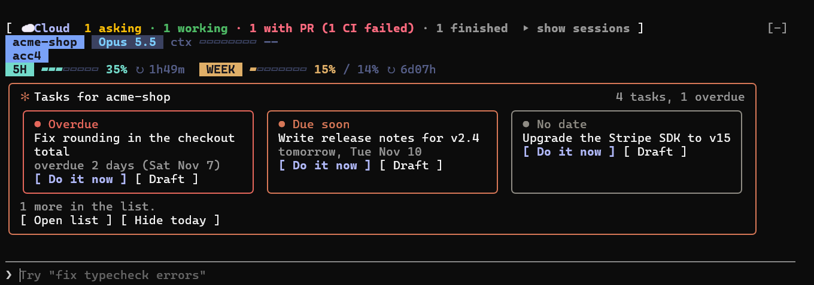

# kit-claude-mods

[](https://github.com/KitTran1307/kit-claude-mods/actions/workflows/ci.yml)
[](LICENSE)
[](https://docs.claude.com/en/docs/claude-code/plugins)
[](#)

Three small mods for [Claude Code](https://claude.com/claude-code) that add what the interface leaves out. They work
in the CLI and in the Claude desktop app, on Windows, macOS and Linux, in English or Vietnamese.

| Plugin | What you get | Needs |
| --- | --- | --- |
| [**kit-cloud**](plugins/kit-cloud) | A band above the prompt with your **cloud sessions**: working, asking you something, PR open, CI failed, silent, each with its link, and a notification when one needs you. `/cloud` for the table. | Node 18+, GitHub CLI `gh` signed in |
| [**kit-statusbar**](plugins/kit-statusbar) | A **status bar** for the desktop app (which has none) and the CLI: repo, model, effort, context use, account, session title, 5-hour and weekly limits with reset countdowns, and a warning when a hook keeps failing. | nothing |
| [**kit-todos**](plugins/kit-todos) | Your project's **open to-dos** above the prompt, most urgent first, with *Do it now* and *Draft* buttons, plus the project's newest memories. `/todo` to add and finish tasks; Claude can suggest tasks for you to approve. | nothing |

All three together in the Claude Code CLI (real screenshot, demo data):



Each one is independent: install only what you want. When several are installed their bands stack above the prompt
and share its height.

## Install

### Let Claude do it

Paste this into a Claude Code session:

> Install plugins from the KitTran1307/kit-claude-mods marketplace,
> following https://github.com/KitTran1307/kit-claude-mods/blob/main/INSTALL.md

Claude asks which of the three you want (pick one, two or all), checks what your machine has, then installs and
verifies only those, following [INSTALL.md](INSTALL.md). To skip the question, name them: "Install kit-todos from …".

### By hand

In a Claude Code **terminal** session, Claude Code 2.1.275 or later (answer `y` to add the marketplace, then pick
the scope, user is the usual one):

```
/plugin install kit-cloud --marketplace KitTran1307/kit-claude-mods
/plugin install kit-statusbar --marketplace KitTran1307/kit-claude-mods
/plugin install kit-todos --marketplace KitTran1307/kit-claude-mods
```

From a shell instead, Claude Code 2.1.292 or later (`claude --version`; `claude update` updates it):

```
claude plugin install kit-todos --marketplace KitTran1307/kit-claude-mods
```

On an older Claude Code, add the marketplace first, then install by plugin id:

```
claude plugin marketplace add KitTran1307/kit-claude-mods
claude plugin install kit-todos@kit-claude-mods
```

In the **desktop app**, where `/plugin` is not available: click **+** next to the prompt box → **Plugins** →
**Add marketplace** → `KitTran1307/kit-claude-mods` → **Add plugin**, and pick the ones you want. A plugin installed
from a terminal at the user scope also loads in the desktop app's local sessions.

New sessions pick the plugins up; in the session where you installed them they are active right away.

### Update and remove

```
claude plugin update kit-todos            # then /reload-plugins in an open session
/plugin uninstall kit-todos
```

## Options

Every plugin has options (which surfaces to draw on, where the to-do file lives, ...). Change them in `/config`, or in
`~/.claude/settings.json`; each plugin's README lists them.

## Privacy

| Plugin | Network |
| --- | --- |
| kit-statusbar | None. Reads local files only: this session's transcript and your login record (for the email). |
| kit-todos | None. Reads and writes your to-do file, reads your memory index. |
| kit-cloud | **Uses the GitHub API** through kit-cloud-pilot and your own `gh` login, and nothing else. By default (`autoWatch`), it watches each GitHub repository you open Claude Code in for new `claude/*` branches. Set `autoWatch` to `false` in `/config` to follow only the sessions you track yourself. |

No plugin sends data to any other service, and none collects telemetry. Details in [SECURITY.md](SECURITY.md).

## Feedback

To report a bug or suggest an idea, open an [issue](https://github.com/KitTran1307/kit-claude-mods/issues/new/choose)
(a form guides you). This repository only publishes releases, so pull requests are closed automatically; please
open an issue instead. For security problems, follow [SECURITY.md](SECURITY.md) and do not open a public issue.

## Development

Each plugin is a Claude Code hooks module (`hooks/register.tsx`) with its tests beside it.

```
claude --plugin-dir plugins/kit-todos         # run a plugin from this folder in one session
claude plugin validate plugins/kit-todos      # what the engine sees and would refuse
claude plugin test plugins/kit-todos          # the plugin's tests against the engine
```

Claude Code writes the engine's type definitions into `plugins/<name>/.claude-plugin/types/` the first time it loads a
plugin from a folder (gitignored); after that `npx -p typescript tsc -p plugins/<name>` type-checks it.

## License

[MIT](LICENSE)
