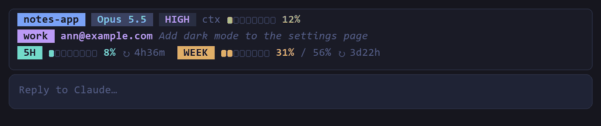
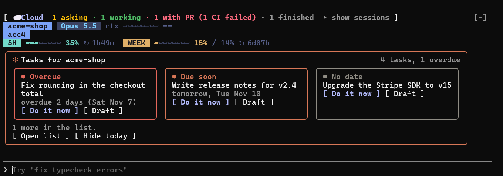

# kit-claude-mods

[](https://github.com/KitTran1307/kit-claude-mods/actions/workflows/ci.yml)
[](LICENSE)
[](https://docs.claude.com/en/docs/claude-code/plugins)
[](#)

**Know how much of your Claude plan is left, before you hit the limit.** Usage Bar shows your 5-hour and weekly
limits with reset countdowns and a daily pace for the week, right above the prompt, in the desktop app too:



*Drawn from the plugin's own render output, with demo data.* Install it in a terminal session:

```
/plugin install usage-bar --marketplace KitTran1307/kit-claude-mods
```

Small mods for [Claude Code](https://claude.com/claude-code) that add what the interface leaves out. They work
in the CLI and in the Claude desktop app, on Windows, macOS and Linux, in English or Vietnamese.

| Plugin | What you get | Needs |
| --- | --- | --- |
| [**kit-cloud**](plugins/kit-cloud) | A band above the prompt with your **cloud sessions**: working, asking you something, PR open, CI failed, silent, each with its link, and a notification when one needs you. `/cloud` for the table. | Node 18+, GitHub CLI `gh` signed in |
| [**Usage Bar**](plugins/usage-bar) (`usage-bar`) | Your **5-hour and weekly limits** at a glance, with reset countdowns and a daily pace, plus repo, model, effort, context, account and session title: a status bar for the desktop app (which has none) and the CLI. | nothing |
| [**kit-todos**](plugins/kit-todos) | Your project's **open to-dos** above the prompt, most urgent first, with *Do it now* and *Draft* buttons, plus the project's newest memories. `/todo` to add and finish tasks; Claude can suggest tasks for you to approve. | nothing (Node 18+ for Claude's suggestions) |
| [**kit-turn**](plugins/kit-turn) | A **summary card at the end of every turn** in plain words: files changed (+/-), tests, time taken, and a *Push now* button when commits are not pushed. A turn clock and `/turn changes`. | Claude Code 2.1.330+ (git, if you use it) |
| [**kit-agents**](plugins/kit-agents) | An **Agent Board**: one card per running subagent with its model, step, context bar and time; a waiting one is highlighted with a Reply button. | Claude Code 2.1.330+ |
| [**kit-graphite**](plugins/kit-graphite) | A **graphite theme** for the desktop and mobile apps: charcoal grays, a dot field frozen mid-wave and a small pixel comet; a matching Windows Terminal look. | Claude Code 2.1.326+ |
| [**Quota Coach**](plugins/quota-coach) (`quota-coach`) | **What is using your plan's limits, and what to do about it**: a one-line tip above the prompt (compact a full context, cold cache, many subagents, a strong model on light work), a *why did that cost so much* card, a pre-send estimate (`This turn ~3% of 5H`) and a daily report by session, model and hour. `/quota why`, `/quota report`. | nothing |
| [**Themes**](plugins/kit-themes) (`kit-themes`) | Three original **themes** for the desktop and mobile apps: **Paper** (warm light), **High Contrast** (WCAG AAA) and **Night** (low blue light). Auto follows light or dark mode, so installing it already shows one; `/themes` picks another or turns it off. | Claude Code 2.1.323+ |
| [**Notify**](plugins/kit-notify) (`kit-notify`) | A **sound and a system notification** when Claude finishes or needs you, a **queue** for the prompts you type while it works (numbered, a **×** on each, sent one at a time), and a **welcome-back card** ("while you were away 25 min: 2 tasks done, 1 question waiting"). `/queue` for the list. | nothing (a recent Claude Code for every part) |
| [**Pet**](plugins/kit-pet) (`kit-pet`) | A small original **pixel pet** above the prompt (Moss, Bun or Jelly): it works when Claude works, cheers when a turn finishes, droops on an error or a low limit, grows as you finish turns and congratulates you on a few milestones. | nothing |
| [**Safety Net**](plugins/kit-safety) (`kit-safety`) | A **safety net for risky commands**: a snapshot before `rm -rf`, `git push --force`, `git reset --hard` and overwriting a `.env`, a plain-language question above the prompt, `/safety restore` to undo, and API keys masked in tool output. | nothing (Node 18+ also saves binary files) |
| [**Status Dot**](plugins/kit-status) (`kit-status`) | A **colored dot** on each session's name in the desktop app's sidebar: working, waiting for a background command, waiting for you, or done. | the desktop app (does nothing elsewhere) |

The three bands together in the Claude Code CLI (real screenshot, demo data):



Each one is independent: install only what you want. When several are installed their bands stack above the prompt
and share its height.

## Install

### Let Claude do it

Paste this into a Claude Code session:

> Install plugins from the KitTran1307/kit-claude-mods marketplace,
> following https://github.com/KitTran1307/kit-claude-mods/blob/main/INSTALL.md

Claude asks which you want (pick any, or all), checks what your machine has, then installs and
verifies only those, following [INSTALL.md](INSTALL.md). To skip the question, name them: "Install kit-todos from …".

### By hand

In a Claude Code **terminal** session, Claude Code 2.1.275 or later (answer `y` to add the marketplace, then pick
the scope, user is the usual one):

```
/plugin install kit-cloud --marketplace KitTran1307/kit-claude-mods
/plugin install usage-bar --marketplace KitTran1307/kit-claude-mods
/plugin install kit-todos --marketplace KitTran1307/kit-claude-mods
/plugin install kit-graphite --marketplace KitTran1307/kit-claude-mods
/plugin install kit-turn --marketplace KitTran1307/kit-claude-mods
/plugin install kit-agents --marketplace KitTran1307/kit-claude-mods
```

From a shell instead, Claude Code 2.1.292 or later (`claude --version`; `claude update` updates it):

```
claude plugin install kit-todos --marketplace KitTran1307/kit-claude-mods
```

On an older Claude Code, add the marketplace first, then install by plugin id:

```
claude plugin marketplace add KitTran1307/kit-claude-mods
claude plugin install kit-todos@kit-claude-mods
```

In the **desktop app**, where `/plugin` is not available: click **+** next to the prompt box → **Plugins** →
**Add marketplace** → `KitTran1307/kit-claude-mods` → **Add plugin**, and pick the ones you want. A plugin installed
from a terminal at the user scope also loads in the desktop app's local sessions.

New sessions pick the plugins up; in the session where you installed them they are active right away.

### Update and remove

```
claude plugin update kit-todos            # then /reload-plugins in an open session
/plugin uninstall kit-todos
```

## Options

Every plugin has options (which surfaces to draw on, where the to-do file lives, ...). Change them in `/config`, or in
`~/.claude/settings.json`; each plugin's README lists them.

## Privacy

| Plugin | Network |
| --- | --- |
| usage-bar | None. Reads local files only: this session's transcript and your login record (for the email). |
| kit-todos | None. Reads and writes your to-do file, reads your memory index. |
| kit-turn | None. Reads this session's tool calls and runs read-only git in your folder. |
| kit-agents | None. Reads this session's live subagent list. |
| kit-notify | None. Reads the prompt box and Claude Code's own events on this computer; writes nothing; plays its sound with the system's own player. |
| kit-cloud | **Uses the GitHub API** through kit-cloud-pilot and your own `gh` login, and nothing else. By default (`autoWatch`), it watches each GitHub repository you open Claude Code in for new `claude/*` branches. Set `autoWatch` to `false` in `/config` to follow only the sessions you track yourself. |
| kit-safety | None. Copies the files a risky command would delete into a folder under your Claude config folder, and reads your project's Git state; masks secrets in memory. |

No plugin sends data to any other service, and none collects telemetry. Details in [SECURITY.md](SECURITY.md).

## Feedback

To report a bug or suggest an idea, open an [issue](https://github.com/KitTran1307/kit-claude-mods/issues/new/choose)
(a form guides you). This repository only publishes releases, so pull requests are closed automatically; please
open an issue instead. For security problems, follow [SECURITY.md](SECURITY.md) and do not open a public issue.

## Development

Each plugin is a Claude Code hooks module (`hooks/register.tsx`) with its tests beside it.

```
claude --plugin-dir plugins/kit-todos         # run a plugin from this folder in one session
claude plugin validate plugins/kit-todos      # what the engine sees and would refuse
claude plugin test plugins/kit-todos          # the plugin's tests against the engine
```

Claude Code writes the engine's type definitions into `plugins/<name>/.claude-plugin/types/` the first time it loads a
plugin from a folder (gitignored); after that `npx -p typescript tsc -p plugins/<name>` type-checks it.

## License

[MIT](LICENSE)
