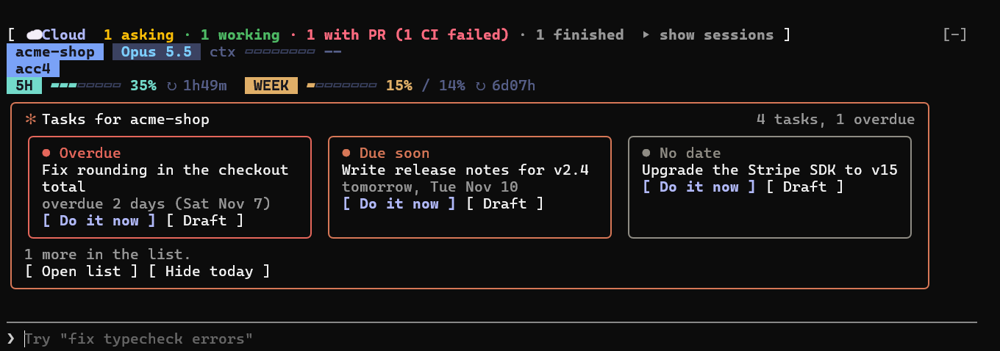
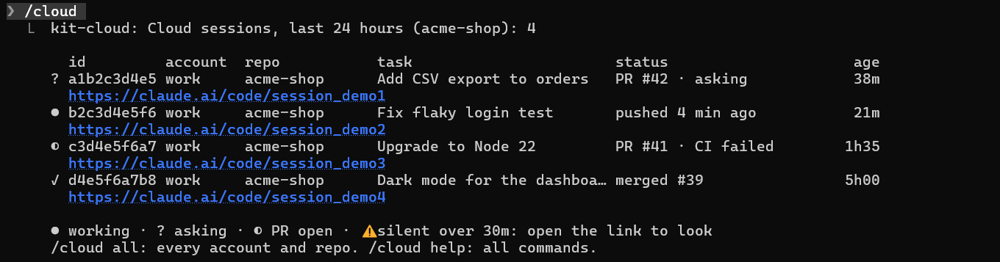

# kit-cloud

See your Claude Code **cloud sessions** right above the prompt, in the CLI and in the desktop app: which are working,
which ask you something, which opened a PR, whose CI failed and which went silent, with a link to each.

The band (top line), here with kit-statusbar and kit-todos under it, in the Claude Code CLI:



Click the band to list each session with its link, or type `/cloud`:



Screenshots are real Claude Code sessions on demo data.

kit-cloud is the band and the `/cloud` command for **[kit-cloud-pilot](https://github.com/KitTran1307/kit-cloud-pilot)**, the tool that lets the Claude
Code CLI start, track, wait for and answer cloud sessions by itself. cloud-pilot does the GitHub work (one cached
background process for all your Claude sessions); kit-cloud reads its state and draws it. Installing kit-cloud
installs kit-cloud-pilot with it.

**Told when it matters:** while your session is open, kit-cloud shows a message and sends a notification the moment a
cloud session asks you a question, opens a PR, fails CI, goes silent or finishes (`notifyInSession`). **Vietnamese**
(tiếng Việt) is built in: the band, `/cloud` and the messages follow Claude Code's `language` setting, or set `language`.

## Requirements

- A recent Claude Code (CLI or desktop app) with plugin hooks modules.
- **Node.js 18+** on `PATH` and the **GitHub CLI** `gh`, signed in (`gh auth login`) with read access to your repos.
  Without them the plugin stays quiet; `/cloud doctor` says what is missing.
- The repo's `origin` remote on GitHub. Cloud sessions push to `claude/...` branches there.

**Network:** unlike kit-statusbar and kit-todos, this plugin uses the network. kit-cloud-pilot uses the GitHub API
through your own `gh` login, and nothing else. By default (`autoWatch`), it watches each GitHub repository you open
Claude Code in for new `claude/*` branches. Set `autoWatch` to `false` in `/config` to follow only the sessions you
track yourself.

## Install

In a Claude Code terminal session:

```
/plugin install kit-cloud --marketplace KitTran1307/kit-claude-mods
```

From a shell (Claude Code 2.1.292 or later): `claude plugin install kit-cloud --marketplace KitTran1307/kit-claude-mods`.
In the desktop app: **+** next to the prompt box → **Plugins** → **Add marketplace** `KitTran1307/kit-claude-mods` →
**Add plugin**. Or ask Claude: *"Install the kit-cloud plugin from the KitTran1307/kit-claude-mods marketplace"*
(see [INSTALL.md](../../INSTALL.md)). Then run `/cloud doctor`.

## How sessions get tracked

- **Automatically** (default `autoWatch`): when Claude starts in a GitHub repo, the hub watches it and tracks each new
  `claude/*` branch, so cloud sessions appear once they push. The first look also picks up branches with an open PR.
- **By hand**: `/cloud track <session link> [claude/branch]`, for a session you want to see from its first minute.
- **From the CLI or scripts**: `cloud-pilot start` starts and tracks a session; `cloud-pilot track ...` tracks one
  (see kit-cloud-pilot's README).

## Commands

| Command | What it does |
| --- | --- |
| `/cloud` | Sessions of this account and repo (see `scope`) with links |
| `/cloud all` | Every session the hub tracks |
| `/cloud track <url> [branch]` | Track a session |
| `/cloud untrack <id>` | Stop tracking (ids are shown by `/cloud`) |
| `/cloud watch`, `/cloud unwatch` | Start or stop watching this repo |
| `/cloud doctor` | Check node, gh and the gh login |

## Options

Set them in `/config` (the plugin's rows), or in `~/.claude/settings.json` under `pluginConfigs`:

```json
{ "pluginConfigs": { "kit-cloud@kit-claude-mods": { "options": { "scope": "repo", "deleteMergedBranches": false } } } }
```

| Option | Default | Meaning |
| --- | --- | --- |
| `scope` | `account+repo` | `account+repo`: this account's sessions in this repo · `repo`: every account's in this repo · `all` |
| `autoWatch` | `true` | Watch the current GitHub repo for new `claude/*` branches |
| `showBand` | `true` | Draw the band (off keeps `/cloud`) |
| `notifications` | `true` | System notification from the cloud-pilot hub when a session needs you and **no** Claude session is open for it (applies to tracks registered after you change it) |
| `notifyInSession` | `true` | While a Claude session **is** open, show a message and a notification when a cloud session starts asking you a question, opens a PR, fails CI, goes silent or finishes. Nothing is replayed when a session starts or reloads. |
| `language` | `auto` | `auto`: follow Claude Code's own `language` setting (Vietnamese when it is set to Vietnamese, English otherwise) · `en` · `vi`. Read when a session starts. |
| `deleteMergedBranches` | `false` | Delete a `claude/*` branch you tracked with `/cloud track` after its PR merges, only while it still points at the merged commit. Branches found by watching (maybe a teammate's) are never deleted. Applies to tracks registered after you change it. |

The "account" is the Claude config folder: `~/.claude` is `default`, `~/.claude-work` (via `CLAUDE_CONFIG_DIR`) is
`work`. Sessions found by watching show for every account in their repo, since GitHub does not say which account
started them. cloud-pilot's own settings are environment variables (see its [README](https://github.com/KitTran1307/kit-cloud-pilot#settings)).

## Privacy and safety

- Only cloud-pilot's hub talks to GitHub, through your own `gh` login; nothing is sent anywhere else. Tokens are never written.
- Text from GitHub is shown as data and never run. Links are drawn only for `https://` URLs.
- Nothing on GitHub is changed unless you turn on `deleteMergedBranches`.
- Data lives in `~/.claude/cloud-pilot` (or `CLOUD_PILOT_DIR`). Delete the folder to forget everything.

## Troubleshooting

- **No band**: nothing is tracked for this account and repo in the last 24 hours (try `/cloud all`), `showBand` is off,
  or a survey is open. `/cloud doctor` checks node and gh.
- **"cloud-pilot stopped … (status may be old)"**: the hub process ended. Any `/cloud track` or `/cloud watch` restarts it.
- **"no cloud-pilot wait running for N tracked sessions"**: this session owns live tracks but nothing waits for their
  events (the background wait ended or was killed, e.g. for low memory). Ask Claude to start `cloud-pilot wait` again;
  the events queued meanwhile are delivered to it.
- **Repo not readable**: `gh auth status` must show an account that can read the repo (`gh auth login`).
- `claude --debug` shows the plugin's own log lines.

## Uninstall

`/plugin uninstall kit-cloud`. kit-cloud-pilot stays installed for the CLI; remove it the same way if you want.
