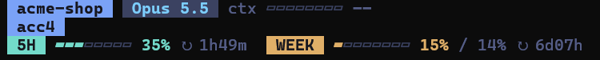

# kit-statusbar

A status band for Claude Code, drawn above the prompt box. The Claude desktop app has no status line of its own, so
this plugin adds one: three rows in the Tokyo Night colors that show where you are and how much of your plan is left.



*Real screenshot in the CLI (email hidden with `showEmail: false`, no session title yet).* In full it reads:

```
 my-repo   Opus 5.5   HIGH   ctx ▰▰▰▱▱▱▱▱ 42%
 work   ann@example.com   fix the nightly export job
 5H ▰▰▱▱▱▱▱▱ 30% ↻ 2h13m   WEEK ▰▰▰▰▰▰▰▱ 93% / 56% ↻ 3d03h
```

1. Repository (or the folder name outside a repo), model, effort, and how full the context window is.
2. The account (a colored label), its email, and the session title (your `/rename`, else the automatic title).
3. The 5-hour limit and the weekly limit, each with a bar and the time until it resets. Next to the weekly bar is a
   daily budget (`/ 56%`): the share of the week you planned to have used by today, current day included, at 14% a
   day by default.

Colors tell you the pace: a bar turns yellow from 70% and red from 90%; the weekly bar also turns yellow when you are
above your daily budget and red when you are a full day's budget over it.

It works in both the Claude desktop app and the `claude` CLI. By default (`surfaces: auto`) the desktop app always
gets the band, and the terminal gets it too unless you already have a status line set up there (a `statusLine` in
your user or project settings), so you never see the same facts twice. When it finds one, it asks you once in the
terminal: **Keep only my status line** (saves `surfaces: desktop`) or **Show both** (saves `surfaces:
desktop+terminal`). Dismiss the question and nothing is saved: the terminal stays with your status line and the
question comes back next session.

## Requirements

- A recent Claude Code: 2.1.275 or later (the version where the one-step install below works). It was written and
  tested on 2.1.319. The plugin uses Claude Code's function-hooks API, which is early access and may change between
  releases.
- The Claude desktop app, or the `claude` command in a terminal. Windows, macOS and Linux all work.
- Node.js is optional. Without it everything works except one case: the session title of a very long session (a
  transcript over 4 MB), where the last title the plugin knew stays on screen.

## Install

In a terminal session:

```
/plugin install kit-statusbar --marketplace KitTran1307/kit-claude-mods
```

Answer `y` to add the marketplace, then pick a scope (the user scope is the first one). A screen then lets you set
the options (you can change them later, see below).

From a shell (Claude Code 2.1.292 or later):

```
claude plugin install kit-statusbar --marketplace KitTran1307/kit-claude-mods
```

In the Claude desktop app: click **+** next to the prompt box, then **Plugins**, then **Add marketplace** with
`KitTran1307/kit-claude-mods`, then **Add plugin** on `kit-statusbar`.

Or let Claude do it: tell Claude "Install the kit-statusbar plugin from the KitTran1307/kit-claude-mods
marketplace". The repository's `INSTALL.md` has the steps Claude follows.

A plugin installed from a terminal at the user scope also loads in the local sessions the desktop app starts.

## Options

| Option | Type | Default | What it does |
| --- | --- | --- | --- |
| `surfaces` | `auto`, `desktop` or `desktop+terminal` | `auto` | Where the band is drawn. `auto`: the desktop app, and the terminal when no status line is set up there (with one, it asks once and saves your answer here). `desktop`: the desktop app only. `desktop+terminal`: both, always. |
| `weeklyBudgetPerDay` | number | `14` | Share of the weekly limit planned per day, shown as `/ 56%` next to the weekly bar. 0 or less hides the budget. |
| `showEmail` | true or false | `true` | Show the account email. The email and the session title can end up in screenshots and shared screens: turn it off before you share your screen; the plugin then does not look the email up at all. |
| `showTitle` | true or false | `true` | Show the session title. Turn it off too when the title could say more than you want on a shared screen. |
| `showLimits` | true or false | `true` | Show the 5-hour and weekly row. It also hides itself when there is no limit data (an API key, a third-party provider). |
| `maxTranscriptMB` | number | `8` | How much of the session transcript is looked at to find the title. The plugin reads up to 4 MB itself; a larger transcript is read from its end by the Node helper, up to this many MB. |

Set them in any of these ways:

- At install time, on the screen the installer shows.
- In the `/config` menu: each option is a row called `kit-statusbar.<option>`. A change reloads the plugin.
- In `~/.claude/settings.json` (or `%USERPROFILE%\.claude\settings.json` on Windows), under `pluginConfigs`. The key
  is the plugin's id, `kit-statusbar@<marketplace>`, and the values go in an `options` object:

  ```json
  {
    "pluginConfigs": {
      "kit-statusbar@kit-claude-mods": {
        "options": {
          "surfaces": "desktop+terminal",
          "weeklyBudgetPerDay": 20,
          "showEmail": false
        }
      }
    }
  }
  ```

  The part after `@` is the name of the marketplace the plugin came from; `claude plugin list` prints the exact id.
  A plugin loaded straight from a folder (`claude --plugin-dir`) is keyed `kit-statusbar@inline`.
- `claude plugin configure kit-statusbar` shows the options and which are unset.

## The account label and color

The account is the Claude config folder the session runs with: the `CLAUDE_CONFIG_DIR` environment variable when it
is set, otherwise `.claude` in your home folder. The label is that folder's name:

| Config folder | Label |
| --- | --- |
| `~/.claude` (the usual one) | `default` |
| `~/.claude-work` | `work` |
| `~/.claude-acc2` | `acc2` |
| any other name, such as `/srv/ai/team-a` or `~/.ai-lab` | `team-a`, `ai-lab` (the name without a leading dot) |

`default` is orange; every other label gets one of seven other colors, chosen from the label itself, so the same
account always has the same color.

## Privacy

The plugin sends nothing anywhere. It makes no network requests. To fill the band it reads two things on your own
machine:

- this session's own transcript (`<config folder>/projects/<project>/<session id>.jsonl`), only to find the session
  title and the account email in it;
- the local login record (`.claude.json`: in the config folder when `CLAUDE_CONFIG_DIR` is set, otherwise in your home
  folder), only for `oauthAccount.emailAddress`, and only when the transcript does not name the account.

The optional Node helper (`scripts/session-info.mjs`) is a small program that does the same reading for files too big
for the plugin; it runs locally and prints only the title and the email back to the plugin.

## Troubleshooting

- **No band.** In the terminal, `auto` steps aside for a status line you already have (`statusLine` in
  `~/.claude/settings.json` or the project's `.claude/settings*.json`): set `surfaces` to `desktop+terminal` to have
  both. On the desktop app,
  check that the plugin is enabled (`claude plugin list`) and try `/reload-plugins`. A band also steps aside while a
  survey is shown above the prompt.
- **No limits row.** There is no rate-limit data to show: Claude Code reports it for subscription plans, not for API
  keys or third-party providers. It appears after the first response if your plan has limits. `showLimits` must be on.
- **No session title.** A new session has none until its first answer. A very long session (transcript over 4 MB)
  needs Node.js installed for the title to update; without it the last known title stays.
- **No email, or the wrong one.** Without a login record the plugin has nothing to show, so no email appears. Check
  `showEmail`, and check which config folder the session uses (`CLAUDE_CONFIG_DIR`).
- **Something else.** Start Claude Code with `claude --debug`: the plugin logs each lookup that fails there, and never
  stops the session for it.

## Uninstall

```
claude plugin uninstall kit-statusbar
```

In a terminal session, `/plugin` opens the same list. To drop the marketplace as well: `claude plugin marketplace
remove kit-claude-mods` (use the name `claude plugin marketplace list` shows). Delete the plugin's `pluginConfigs`
entry from `settings.json` if you set options by hand.

## Development

```
claude plugin validate .
npx -p typescript tsc -p . --noEmit
claude plugin test .
node --test scripts/
```

`hooks/register.tsx` holds the hooks and the drawing; `hooks/format.ts`, `account.ts`, `config.ts` and
`transcript.ts` hold the pure helpers and the file lookups. `scripts/session-info.mjs` is the optional Node helper.
