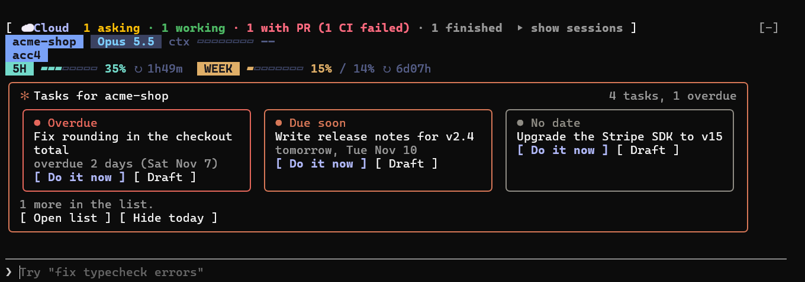
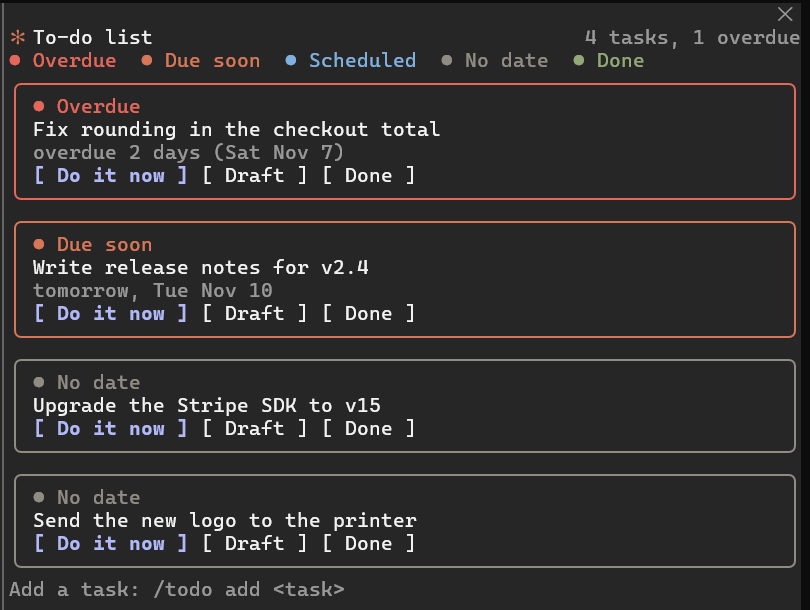

# kit-todos

A to-do band for Claude Code. When you open a session it shows the open tasks of the project you are in, most
urgent first, in a band above the prompt. One press hands a task to Claude ("Do it now"), drafts it into the prompt
("Draft"), hides the band for the day ("Hide today") or opens a full list ("Open list"). The tasks live in one plain
JSON file you control, shared by every project and every Claude Code surface on your machine. The same plugin adds
a `/todo` command, a pane with the whole list, a task count in the status line, and the project's latest memory.



`/todo` (or **Open list**) opens the whole list beside the conversation:



*Real screenshots of Claude Code on demo data.*

```
╭───────────────────────────────────────────────────────────────╮
│ ✻ Tasks for my-app                         2 tasks, 1 overdue │
│ ╭────────────────────────────╮ ╭────────────────────────────╮ │
│ │ ● Overdue                  │ │ ● Due soon                 │ │
│ │ Fix the login redirect     │ │ Write the release notes    │ │
│ │ overdue 2 days (Sat Nov 7) │ │ tomorrow, Tue Nov 10       │ │
│ │ [ Do it now ] [ Draft ]    │ │ [ Do it now ] [ Draft ]    │ │
│ ╰────────────────────────────╯ ╰────────────────────────────╯ │
│ ● Overdue  ● Due soon  ● Scheduled  ● No date  ● Done         │
│ Latest memory: Release checklist, 4 saved                     │
│ [ Open list ] [ Hide today ]                                  │
╰───────────────────────────────────────────────────────────────╯
```

The band sizes itself to the room it is given: cards when there is space, one row per task in a short terminal,
and a single line when there is almost no room. It never scrolls.

## Requirements

- A recent Claude Code with plugin hooks modules. The one-line installs below need 2.1.275 or later in a session
  (`/plugin install … --marketplace`) and 2.1.292 or later from a shell (`claude plugin install … --marketplace`).
- The Claude Code CLI or the Claude desktop app, on Windows, macOS or Linux.
- Nothing else: no Node, no Python, no account. The plugin only reads and writes your todos file and reads the
  project's memory index; it uses no network.

## Install

- In a terminal session:

  ```
  /plugin install kit-todos --marketplace KitTran1307/kit-claude-mods
  ```

  Answer `y` to add the marketplace, pick a scope, and set the options on the screen that follows (or accept the defaults).

- From a shell (Claude Code 2.1.292 or later):

  ```
  claude plugin install kit-todos --marketplace KitTran1307/kit-claude-mods
  ```

- In the desktop app: click **+** next to the prompt box, then **Plugins**, **Add marketplace** with
  `KitTran1307/kit-claude-mods`, then **Add plugin** and pick `kit-todos`.

- Let Claude do it: tell Claude "Install the kit-todos plugin from the KitTran1307/kit-claude-mods marketplace".
  The repository has an `INSTALL.md` that Claude follows.

The plugin is active in the session you installed it from, and in every session you start afterwards.

## Options

| Option | Type | Default | What it does |
| --- | --- | --- | --- |
| `todosFile` | string | `~/.claude/kit-todos/todos.json` | The JSON file that holds your tasks. `~` and `~/` mean your home folder, a relative path is taken from your home folder, and both `/` and `\` work. A missing file is an empty list; the first `/todo add` creates it. |
| `soonDays` | number | `2` | A task due within this many days is "Due soon". Whole number from 0 to 30; anything else becomes 2. |
| `showBand` | boolean | `true` | `false` never draws the band. The `/todo` command, the pane and the count in the status line keep working. |
| `showMemories` | boolean | `true` | Show the project's newest memory in the band and the latest ones in the pane. |
| `memoriesAllProfiles` | boolean | `false` | Read memories from every account profile (`~/.claude` and each `~/.claude-*`), not just the current one. Off by default so one account's memories never show in another's session. |

Set them in any of these ways:

- At install time, on the screen the terminal shows.
- Later, in the `/config` menu: each option is a row. A change reloads the plugin at once.
- Or in `~/.claude/settings.json` (this works everywhere, including the desktop app). Options are stored under
  `pluginConfigs`, keyed by the plugin's id, which is its name and its marketplace, `kit-todos@kit-claude-mods`:

  ```json
  {
    "pluginConfigs": {
      "kit-todos@kit-claude-mods": {
        "options": {
          "todosFile": "~/Documents/todos.json",
          "soonDays": 3,
          "showBand": true,
          "showMemories": false
        }
      }
    }
  }
  ```

  Only the options you list change. `claude plugin configure kit-todos` shows the options and which are unset.

## Commands

| Command | What it does |
| --- | --- |
| `/todo` | Opens the pane and lists this project's open tasks, numbered, with the path of the todos file. Also shows the band again if you hid it. |
| `/todo add <task>` | Adds a task for the current project to the file. The first one creates the file. |
| `/todo done <number>` | Marks a task done, using its number in the last `/todo` list of this session. It stays visible in the pane for 24 hours. |
| `/todo claim` | Links the open tasks for this folder name to this repository. Use it for tasks created before version 1.3 (other folders with the same name stop showing them) and for tasks hidden after you moved this repository or changed its remote. `/todo` tells you when this is needed. |

Without a task or a number, `/todo add` and `/todo done` print their usage and change nothing. The number in
`/todo done` always refers to the last `/todo` list in this session, even if another session has changed the list
since. In a new session, run `/todo` first. If that task is no longer in the file, nothing is changed and the reply
says so.

Buttons: **Do it now** sends the task to Claude as a prompt (and hides the band for the day), **Draft** only puts it
in the prompt box so you can edit it first, **Done** (in the pane) marks it done, **Open list** opens the pane,
**Hide today** hides the band until tomorrow. The pane draws 50 open tasks at first; **Show more** draws 50 more.

**Do it now** sends at once only when the card shows everything the prompt carries. When the task has a `note`, text
longer than the card shows, wider than a one-line list row shows (a short terminal), or on several lines, an `id` outside letters, digits, `.`, `_` and `-` (64 at most), or invisible characters
(control, zero-width or bidi marks), it drafts the whole prompt into the prompt box instead, so you read it before you
send it. This keeps a todos file edited by someone else, or imported, from slipping instructions you never saw to Claude.

The prompt Claude receives names your todos file and asks it to set `"done": true` and `"doneAt"` (the current UTC
time) on that task once it is finished and verified, and to ask you before it decides anything on your behalf.

## The todos file

A JSON array of tasks. Edit it by hand, let Claude edit it, or use `/todo add`.

```json
[
  { "id": "t1", "text": "Fix the login redirect", "project": "my-app", "due": "2026-11-07", "done": false },
  { "id": "t2", "text": "Write the release notes", "note": "Use CHANGELOG.md as the source.", "project": "my-app", "due": "2026-11-10", "done": false },
  { "id": "t3", "text": "Renew the domain", "done": false },
  { "id": "t4", "text": "Deploy the preview", "project": "my-app", "done": true, "doneAt": "2026-11-08T20:00:00.000Z" }
]
```

| Field | Required | Meaning |
| --- | --- | --- |
| `id` | yes | A non-empty string; keep it to letters, digits, `.`, `_` and `-` (64 at most), or **Do it now** drafts instead of sending. Claude is told this id when you hand it a task. Make them unique; repeats still work (see below). |
| `text` | yes | The task. Long text is shortened on screen, but Claude gets all of it. |
| `note` | no | Extra detail sent to Claude with the task. |
| `project` | no | The folder name of the project's git repository (or of the working folder when it is not a repository), compared ignoring case. Used to find the task only when it has no `repo`. A task with neither `project` nor `repo` shows in every project. |
| `repo` | no | The repository the task belongs to; `/todo add` and `/todo claim` set it. It is `git:<host>/<owner>/<name>` from the `origin` remote, so the task stays with the repository when you rename or re-clone the folder. Without a remote it is `path:<folder>`. When set, the task shows only in that repository. |
| `due` | no | A day, `YYYY-MM-DD`. Anything else (`2026-11-9`, `2026-02-30`, `tomorrow`) counts as no date. |
| `done` | no | `true` when finished. Anything but `true` means open. |
| `doneAt` | no | When it was marked done, an ISO 8601 UTC time. Done tasks show in the pane for 24 hours after this. |

Status labels: **Overdue** (due before today), **Due soon** (due within `soonDays`), **Scheduled** (due later),
**No date**, **Done**. Tasks are ordered most urgent first, then by due date, then in file order. Dates are read in
your machine's local time, and written in English ("today, Mon Nov 9", "tomorrow, Tue Nov 10", "overdue 2 days
(Sat Nov 7)", "Fri Nov 13").

## Data safety

- A todos file that cannot be parsed (broken JSON, or JSON that is not a list) is never overwritten. A notification
  says why, `/todo` and the pane show a warning, and nothing is written until you fix the file.
- Entries the plugin cannot show (no `id`, no `text`, not an object) are left exactly as they are when it writes.
  It only adds entries (`/todo add`), sets `done` and `doneAt` (`/todo done`, **Done**) or sets `repo`
  (`/todo claim`). It never deletes or reorders entries.
- Several sessions can save the list at the same time. They take turns using a small lock file next to it
  (`todos.json.lock`, safe to delete when no session is saving). After saving, a session checks that its change is in
  the file. If someone else (an editor, or Claude finishing a task) saved over it at that moment, the change is
  applied again. If the lock stays busy for a few seconds, nothing is saved and you are told.
- "Done" marks the entry you picked, even when several share an id. If the file changed since the list was shown
  and the plugin cannot tell which entry you meant, it writes nothing and says so.
- When the plugin writes, it saves the file as JSON indented by two spaces, so the formatting of a hand-edited file
  may change; the content and the extra fields of every entry are kept.
- A missing file is an empty list, not an error. A file with a byte order mark (some Windows editors add one) is read.
- The plugin never stops a session from starting: if the file system or environment fails, it simply shows less.

## Troubleshooting

The band is not showing:

1. `showBand` is `false` (check `/config`).
2. There are no open tasks for this project. A task with `repo` shows only in that repository; a task with only
   `project` shows only in folders with that name. Run `/todo` to see what the plugin found and which file it reads
   (`List file:`). If you renamed the folder of a task created before version 1.3, change its `project` to the new
   name, then run `/todo claim`.
3. You pressed **Hide today** or **Do it now**. The band returns tomorrow, or run `/todo` to bring it back.
4. A question dialog (survey) is open, or Claude is working. The band comes back when it is idle.
5. The todos file cannot be read: `/todo` prints a `Warning:` with the reason. Check the path in `todosFile`.
6. The plugin is not enabled: check `/plugin`.

The latest memory is missing: `showMemories` is `false`, or Claude Code has no memory index yet for this project.
Memories are read from `<config folder>/projects/<project>/memory/MEMORY.md` of the current profile only
(`$CLAUDE_CONFIG_DIR`, else `~/.claude`). With `memoriesAllProfiles` on, `~/.claude` and every `~/.claude-*` folder
are read too and the newest one wins (another account's memories can then show in this session).

Still stuck: start Claude Code with `claude --debug` and look for lines that begin with `kit-todos:`. They say when
a hook was skipped and why.

## Uninstall

- Terminal session: `/plugin`, pick `kit-todos`, uninstall. Or from a shell: `claude plugin uninstall kit-todos`.
- Desktop app: open the same Plugins menu and remove it.

Your todos file is not touched. To drop the marketplace too: `claude plugin marketplace remove kit-claude-mods`.
