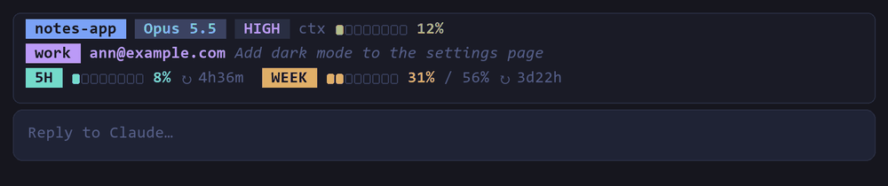
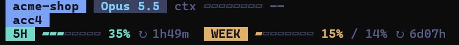

# Usage Bar

**Know how much of your Claude plan is left, before you hit the limit.** Usage Bar is a status band drawn above the
prompt box: your 5-hour and weekly limits with reset countdowns and a daily pace for the week, plus the repo, model,
effort and context. The Claude desktop app has no status line of its own, so this is the one place it shows there.



*Drawn from the plugin's own render output, with demo data.* Plans without a 5-hour window, API keys and third-party
providers simply show what they have.

```
/plugin install usage-bar --marketplace KitTran1307/kit-claude-mods
```



*Real screenshot in the CLI (email hidden with `showEmail: false`, no session title yet).* In full it reads:

```
 my-repo   Opus 5.5   HIGH   ctx ▰▰▰▱▱▱▱▱ 42%
 work   ann@example.com   fix the nightly export job
 5H ▰▰▱▱▱▱▱▱ 30% → 60% ↻ 2h13m   WEEK ▰▰▰▰▰▰▰▱ 93% / 56% ↻ 3d03h
```

(The screenshot above predates the cache clock and the forecast; with them, the first row ends with `◷ cache 4:07`
and the 5H row has the `→ 60%` guess after its percentage.)

1. Repository (or the folder name outside a repo), model, effort, how full the context window is, and the prompt-cache
   clock (`◷ cache 4:07`).
2. The account (a colored label), its email, and the session title (your `/rename`, else the automatic title).
3. The 5-hour limit and the weekly limit, each with a bar and the time until it resets. The 5-hour one also has a
   forecast (`→ 60%`). Next to the weekly bar is a
   daily budget (`/ 56%`): the share of the week you planned to have used by today, current day included, at 14% a
   day by default.

When a hook fails in the session (a script that no longer exists, a plugin folder that was deleted), Claude Code only
logs it quietly, so the band adds a yellow warning at the end of the first row, for example `⚠ 3 hook errors (Stop)`.
Press it to see the hook that failed last, its command and why. The count is read from the session's own transcript
and starts again with every new session.

## Cache clock and forecast

**The cache clock** (`◷ cache 4:07`, at the end of the first row). Claude does not re-read your whole conversation from
scratch on every message: it keeps it in a short-lived cache, and a message sent while the cache is still warm is
cheaper and quicker. The clock counts down how long that cache stays warm after Claude's last reply: normally 5
minutes, or an hour when Claude Code asked for the longer cache. It is green while warm, yellow and bold in the last
minute, and a red bold `◷ cache cold` once it has run out (the next message then re-reads everything, which uses a
little more of your limit). It is hidden before the first reply of a session. It reads the time of the last reply from
this session's own transcript; nothing leaves your computer. It counts seconds only while it is on screen and warm;
if a once-a-second timer is not available, it shows whole minutes (`◷ cache 4m`, `<1m`) instead.

**The 5-hour forecast** (`→ 60%`, right after the 5H percentage). A guess of where the 5-hour limit will stand when
its window ends, if you keep working at the pace so far: the percentage used divided by the share of the window that
has passed. It appears once a tenth of the window has passed (and not at 0%). It is grey below 80%, yellow from 80%
and bold red from 100%, which means you are on course to run out before the reset. It is only a straight-line guess:
a quiet half hour changes it. The weekly row has no forecast.

**The stale marker** (`⟳ old 6m`, at the end of the limits row). The limit numbers come from Claude Code with its
replies. If they have not refreshed for more than 5 minutes while the session is open (you stepped away, or a long
task is running), the row is drawn dim and says how many whole minutes old the numbers are, so you know not to trust
them to the minute. It clears with the next reply.

Both the clock and the forecast are on by default; turn them off with `showCacheClock` and `showForecast` (see
Options).

Colors tell you the pace: a bar turns yellow from 70% and red from 90%; the weekly bar also turns yellow when you are
above your daily budget and red when you are a full day's budget over it.

It works in the Claude desktop and mobile apps and in the `claude` CLI (the VS Code extension draws no band above the
prompt, so nothing shows there). By default (`surfaces: auto`) the desktop and mobile apps always
gets the band, and the terminal gets it too unless you already have a status line set up there (a `statusLine` in
your user or project settings), so you never see the same facts twice. When it finds one, it asks you once in the
terminal: **Keep only my status line** (saves `surfaces: desktop`) or **Show both** (saves `surfaces:
desktop+terminal`). Dismiss the question and nothing is saved: the terminal stays with your status line and the
question comes back next session.

## Requirements

- A recent Claude Code: 2.1.275 or later (the version where the one-step install below works). It was written and
  tested on 2.1.319. The plugin uses Claude Code's function-hooks API, which is early access and may change between
  releases.
- The Claude desktop app, or the `claude` command in a terminal. Windows, macOS and Linux all work.
- Node.js is optional. Without it everything works except one case: the session title of a very long session (a
  transcript over 4 MB), where the last title and cache clock the plugin knew stay on screen.

## Install

In a terminal session:

```
/plugin install usage-bar --marketplace KitTran1307/kit-claude-mods
```

Answer `y` to add the marketplace, then pick a scope (the user scope is the first one). A screen then lets you set
the options (you can change them later, see below).

From a shell (Claude Code 2.1.292 or later):

```
claude plugin install usage-bar --marketplace KitTran1307/kit-claude-mods
```

In the Claude desktop app: click **+** next to the prompt box, then **Plugins**, then **Add marketplace** with
`KitTran1307/kit-claude-mods`, then **Add plugin** on `usage-bar`.

Or let Claude do it: tell Claude "Install the usage-bar plugin from the KitTran1307/kit-claude-mods
marketplace". The repository's `INSTALL.md` has the steps Claude follows.

A plugin installed from a terminal at the user scope also loads in the local sessions the desktop app starts.

## Options

| Option | Type | Default | What it does |
| --- | --- | --- | --- |
| `surfaces` | `auto`, `desktop` or `desktop+terminal` | `auto` | Where the band is drawn. `auto`: the desktop app, and the terminal when no status line is set up there (with one, it asks once and saves your answer here). `desktop`: the desktop app only. `desktop+terminal`: both, always. |
| `language` | `auto`, `en` or `vi` | `auto` | The language of the band's words (labels, the hook warning, the once-asked status line question). `auto`: Vietnamese when Claude Code's own `language` setting is Vietnamese (looked up once at session start), English otherwise. `en` or `vi` forces one. Model names, repository names, numbers and units such as `2h13m` stay as they are. |
| `weeklyBudgetPerDay` | number | `14` | Share of the weekly limit planned per day, shown as `/ 56%` next to the weekly bar. 0 or less hides the budget. |
| `showEmail` | true or false | `true` | Show the account email. The email and the session title can end up in screenshots and shared screens: turn it off before you share your screen; the plugin then does not look the email up at all. |
| `showTitle` | true or false | `true` | Show the session title. Turn it off too when the title could say more than you want on a shared screen. |
| `showLimits` | true or false | `true` | Show the 5-hour and weekly row. It also hides itself when there is no limit data (an API key, a third-party provider). |
| `showHookErrors` | true or false | `true` | Show the failing-hooks warning. Turn it off and the plugin does not look for hook failures in the transcript. |
| `showCacheClock` | true or false | `true` | Show the prompt-cache clock (`◷ cache 4:07`). Turn it off and the plugin does not show it and skips the reply time when it reads the transcript itself (the Node helper for transcripts over 4 MB always includes it; the plugin discards it). The clock is hidden while a turn is running, since the cache is touched at every step, and comes back with the next reply's time. |
| `showForecast` | true or false | `true` | Show the 5-hour forecast (`→ 60%`) after the 5H percentage. |
| `maxTranscriptMB` | number | `8` | How much of the session transcript is looked at to find the title and the hook failures. The plugin reads up to 4 MB itself; a larger transcript is read from its end by the Node helper, up to this many MB. |

Set them in any of these ways:

- At install time, on the screen the installer shows.
- In the `/config` menu: each option is a row called `usage-bar.<option>`. A change reloads the plugin.
- In `~/.claude/settings.json` (or `%USERPROFILE%\.claude\settings.json` on Windows), under `pluginConfigs`. The key
  is the plugin's id, `usage-bar@<marketplace>`, and the values go in an `options` object:

  ```json
  {
    "pluginConfigs": {
      "usage-bar@kit-claude-mods": {
        "options": {
          "surfaces": "desktop+terminal",
          "weeklyBudgetPerDay": 20,
          "showEmail": false
        }
      }
    }
  }
  ```

  The part after `@` is the name of the marketplace the plugin came from; `claude plugin list` prints the exact id.
  A plugin loaded straight from a folder (`claude --plugin-dir`) is keyed `usage-bar@inline`.
- `claude plugin configure usage-bar` shows the options and which are unset.

## The account label and color

The account is the Claude config folder the session runs with: the `CLAUDE_CONFIG_DIR` environment variable when it
is set, otherwise `.claude` in your home folder. The label is that folder's name:

| Config folder | Label |
| --- | --- |
| `~/.claude` (the usual one) | `default` |
| `~/.claude-work` | `work` |
| `~/.claude-acc2` | `acc2` |
| any other name, such as `/srv/ai/team-a` or `~/.ai-lab` | `team-a`, `ai-lab` (the name without a leading dot) |

`default` is orange; every other label gets one of seven other colors, chosen from the label itself, so the same
account always has the same color.

## Privacy

The plugin sends nothing anywhere. It makes no network requests. Full policy: [PRIVACY.md](PRIVACY.md). It also reads
your Claude Code `settings.json` files (only to see whether you already have a status line) and saves one option,
`surfaces`, when you answer its one question. To fill the band it reads two things on your own machine:

- this session's own transcript (`<config folder>/projects/<project>/<session id>.jsonl`), only to find the session
  title, the account email, the hook failures in it, and the time and cache counters of the last reply (the cache
  clock);
- the local login record (`.claude.json`: in the config folder when `CLAUDE_CONFIG_DIR` is set, otherwise in your home
  folder), only for `oauthAccount.emailAddress`, and only when the transcript does not name the account.

The optional Node helper (`scripts/session-info.mjs`) is a small program that does the same reading for files too big
for the plugin; it runs locally and prints only the title, the email, the cache clock's timestamp and the hook failure summary (count, hook name, command, first line of the reason) back
to the plugin. For a transcript that large the failures counted are those in the part it reads, the last `maxTranscriptMB`
MB.

## The doctor

Type `/usage-bar doctor` for a quick self-check. It prints one line per check, `PASS <name> - <detail>`, `WARN <name> -
<detail> Fix: <hint>` or `FAIL ...`: the Claude Code version, Node (optional), this session's transcript, anything
that hides part of the band (the `surfaces` option, a terminal status line, an option turned off), whether limit data
has arrived (none is normal with an API key or a third-party provider) and the config folder. A missing optional piece
is a warning, never a problem you must fix. It never prints your email, tokens, file contents or credential paths.
`/usage-bar` alone prints its usage line.

## Troubleshooting

- **No band.** In the terminal, `auto` steps aside for a status line you already have (`statusLine` in
  `~/.claude/settings.json` or the project's `.claude/settings*.json`): set `surfaces` to `desktop+terminal` to have
  both. On the desktop app,
  check that the plugin is enabled (`claude plugin list`) and try `/reload-plugins`. A band also steps aside while a
  survey is shown above the prompt.
- **No limits row.** There is no rate-limit data to show: Claude Code reports it for subscription plans, not for API
  keys or third-party providers. It appears after the first response if your plan has limits. `showLimits` must be on.
- **No session title.** A new session has none until its first answer. A very long session (transcript over 4 MB)
  needs Node.js installed for the title to update; without it the last known title stays.
- **A hook warning in the band.** The session's transcript records a hook that failed; press the warning to see which
  one. The usual causes are a hook command pointing at a script that was moved or deleted, or a hook of a plugin that
  was uninstalled. Fix or remove the hook in `settings.json` or the plugin; the count stays for the rest of the session.
  Turn the warning off with `showHookErrors: false`.
- **Not sure what is wrong?** Run `/usage-bar doctor` (see above).
- **The band is in the wrong language.** `language: auto` follows Claude Code's `language` setting, read once when the
  session starts; set `language` to `en` or `vi` to choose directly.
- **No email, or the wrong one.** Without a login record the plugin has nothing to show, so no email appears. Check
  `showEmail`, and check which config folder the session uses (`CLAUDE_CONFIG_DIR`).
- **Something else.** Start Claude Code with `claude --debug`: the plugin logs each lookup that fails there, and never
  stops the session for it.

## Uninstall

```
claude plugin uninstall usage-bar
```

In a terminal session, `/plugin` opens the same list. To drop the marketplace as well: `claude plugin marketplace
remove kit-claude-mods` (use the name `claude plugin marketplace list` shows). Delete the plugin's `pluginConfigs`
entry from `settings.json` if you set options by hand.

## Development

```
claude plugin validate .
npx -p typescript tsc -p . --noEmit
claude plugin test .
node --test scripts/
```

`hooks/register.tsx` holds the hooks and the drawing; `hooks/format.ts`, `account.ts`, `config.ts` and
`transcript.ts` hold the pure helpers and the file lookups; `hooks/i18n.ts` holds every word the band shows in English
and Vietnamese (both tables have the same keys, so a missing translation fails `tsc`). `scripts/session-info.mjs` is the optional Node helper.
